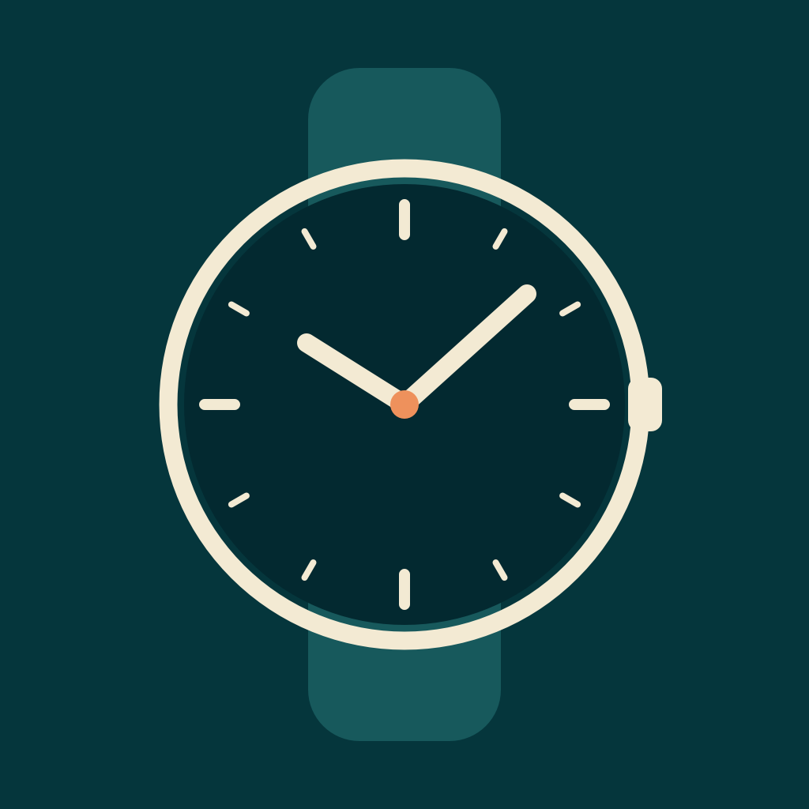
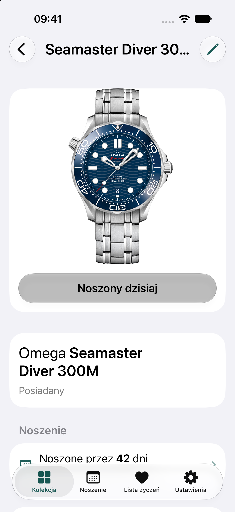

  

<h1 align="center">Moje Zegarki</h1>

  <strong>Twoja kolekcja. Twój rytm. Twoja historia.</strong> 
  Zegarki, które masz. Dni, w których je nosisz. Modele, o których marzysz. 
  W jednej aplikacji na iPhone’a.

  
  
  

<h3 align="center">Technologie</h3>

  
  
  
  
  

  <picture>
    <source media="(prefers-color-scheme: dark)" srcset=".github/assets/screenshots/kolekcja-dark.png">
    <source media="(prefers-color-scheme: light)" srcset=".github/assets/screenshots/kolekcja.png">
    
  </picture>
  &nbsp;
  <picture>
    <source media="(prefers-color-scheme: dark)" srcset=".github/assets/screenshots/zegarek-dark.png">
    <source media="(prefers-color-scheme: light)" srcset=".github/assets/screenshots/zegarek.png">
    
  </picture>
  &nbsp;
  <picture>
    <source media="(prefers-color-scheme: dark)" srcset=".github/assets/screenshots/lista-zyczen-dark.png">
    <source media="(prefers-color-scheme: light)" srcset=".github/assets/screenshots/lista-zyczen.png">
    
  </picture>

Zdjęcia OMEGA i Rolex należą do ich właścicieli; brak powiązania z markami. <a href=".github/assets/README.md#fotografie-zegarków">Źródła i informacje o prawach do zdjęć →</a>

## Kolekcja z kontekstem

Pierwszy automat, pamiątka po ważnej okazji, codzienny towarzysz. Zegarek to więcej niż marka i model — zachowaj to, co czyni go Twoim.

- **Miej kolekcję pod ręką.** Zdjęcia, referencje, dane zakupu i własne notatki w jednej karcie zegarka.
- **Nie szukaj dokumentów po folderach.** Dołącz fakturę, gwarancję lub inny dokument jako PDF albo zdjęcie.
- **Zachowaj historię po rozstaniu.** Przenieś sprzedany zegarek do Archiwum razem z historią noszenia i załącznikami.

Bez limitu liczby zegarków, zdjęć i dokumentów. Pojedynczy dokument może mieć do 20 MB.

## Zobacz, po co naprawdę sięgasz

Który zegarek najczęściej trafia na nadgarstek? Oznacz noszenie jednym przyciskiem i pozwól, by historia odpowiedziała za Ciebie.

  <picture>
    <source media="(prefers-color-scheme: dark)" srcset=".github/assets/screenshots/noszenie-dark.png">
    <source media="(prefers-color-scheme: light)" srcset=".github/assets/screenshots/noszenie.png">
    
  </picture>
  &nbsp;&nbsp;
  <picture>
    <source media="(prefers-color-scheme: dark)" srcset=".github/assets/screenshots/statystyki-dark.png">
    <source media="(prefers-color-scheme: light)" srcset=".github/assets/screenshots/statystyki.png">
    
  </picture>

- **Dzisiaj jednym ruchem, wcześniejsze dni partiami.** Uzupełniaj kalendarz, zaznaczając kilka dat naraz.
- **Cała kolekcja lub jeden model.** Sprawdzaj, co było noszone konkretnego dnia, i wracaj do historii wybranego zegarka.
- **Porównanie zamiast zgadywania.** Zobacz dni noszenia i udział modeli w zapisanej historii z ostatnich 30 dni, bieżącego roku lub całego okresu.

## Od listy życzeń do własnej kolekcji

Zapisz model, który chodzi Ci po głowie — ze zdjęciem, linkiem, orientacyjną ceną i notatką. Ustal priorytet i kolejność, a po zakupie przenieś go do kolekcji bez przepisywania danych. Przypadkowe szybkie przeniesienie możesz cofnąć.

## Prywatna kolekcja. Po Twojemu.

**Bez konta. Bez reklam. Bez zewnętrznej analityki.** Kolekcja, zdjęcia, dokumenty i historia są przechowywane lokalnie, więc aplikacja działa także bez internetu.

Opcjonalna blokada Face ID lub kodem urządzenia chroni dostęp do aplikacji, a przy włączonej blokadzie jej zawartość jest zasłaniana w przełączniku aplikacji. Interfejs obsługuje polski i angielski, jasny i ciemny motyw, VoiceOver oraz systemowe rozmiary tekstu.

## Pod maską

Natywna aplikacja w **Swift 6**, z interfejsem **SwiftUI** i lokalną bazą **SwiftData**. Bez własnego backendu i zewnętrznych zależności pakietowych. Logika domenowa, przechowywanie danych i usługi plikowe są oddzielone od widoków, a schemat bazy jest wersjonowany i objęty migracjami.

Testy automatyczne obejmują reguły domenowe, migracje, trwałość danych, obsługę plików i przepływy UI. Testy interfejsu korzystają z izolowanej bazy; macierz regresji uwzględnia oba języki, oba motywy i duży tekst. Projekt jest sprawdzany na symulatorach i fizycznym iPhonie.

## Dowiedz się więcej

[Galeria aplikacji](#galeria) · [Pochodzenie zdjęć](.github/assets/README.md) · [Licencja](LICENSE) · [Zasady zgłoszeń](CONTRIBUTING.md)

Błąd lub pomysł? [Otwórz zgłoszenie](https://github.com/MrDeex1k/MojeZegarki/issues) lub [rozpocznij dyskusję](https://github.com/MrDeex1k/MojeZegarki/discussions). Problemy bezpieczeństwa zgłaszaj prywatnie, zgodnie z [SECURITY.md](SECURITY.md).
