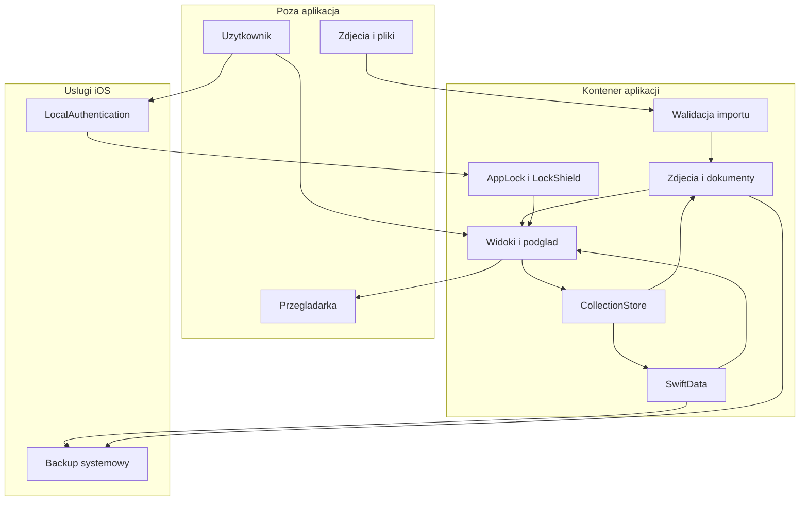

# Model zagrożeń aplikacji Moje Zegarki

## Executive summary

Najważniejsze powierzchnie tej lokalnej aplikacji to import obcych plików, prywatna baza i załączniki oraz zasłona uwierzytelnienia. Kod ogranicza import do 20 MB, zmniejsza obrazy, waliduje pliki i nazwy, używa katalogu prywatnego aplikacji oraz jawnych zapisów z wycofaniem po błędzie zapisu. Nie wykazano zdalnego odczytu danych ani obejścia blokady. Priorytetem jest odporność na kosztowne pliki, spójna polityka ochrony danych i backupu oraz niezależne sprzątanie osieroconych zasobów. Zagrożenia poniżej są scenariuszami do oceny, nie listą potwierdzonych exploitów.

## Scope and assumptions

- Kod bazowy `6efe09d`, branch `audit/app-review`, 19 października 2026.
- Użytkownik potwierdził aktualny zakres: aplikacja lokalna, bez konta, backendu, synchronizacji ani planowanej chmury w tym audycie. Faktury, zakup, notatki i numery seryjne traktujemy jako prywatne.
- Runtime: `MojeZegarki/App`, `Domain`, `Persistence`, `Services`, `Features`, konfiguracja targetu i manifest prywatności. Dokumenty i zdjęcia dostarczane przez użytkownika mogą pochodzić od niezaufanego nadawcy.
- iOS sandbox, system plików i LocalAuthentication są granicami zaufania platformy. Nie zakładamy jailbreaka, przejęcia jądra, pełnego dostępu do kontenera przez inną zwykłą aplikację ani zdalnego endpointu, którego nie ma w kodzie.
- Systemowy backup jest odrębny od synchronizacji aplikacji. Nie potwierdzono na urządzeniu konkretnej konfiguracji backupu ani klasy ochrony wszystkich plików SQLite/WAL/SHM.
- Narzędzia/testy: argumenty testowe są ograniczone do `#if DEBUG`, a UI testy korzystają z odrębnej bazy. Nie oceniano bezpieczeństwa konta GitHub i konfiguracji podpisywania poza repozytorium. Brak workflow CI w przejrzanym `.github` nie dowodzi braku automatyzacji poza nim.

Pytania, które zmieniłyby ranking w przyszłości: czy produkt ma obiecywać brak danych w jakimkolwiek backupie; czy ma chronić dane przed osobą znającą kod urządzenia. Obecna polityka `deviceOwnerAuthentication` celowo dopuszcza kod telefonu, więc nie daje niezależnego hasła kolekcji.

## System model

### Primary components

- `MojeZegarkiApp.load` tworzy `CollectionStore`, wykonuje reconciliation i pokazuje `RootView`; `LockShield` działa również nad arkuszami. Dowody: `App/MojeZegarkiApp.swift:59`, `App/LockShield.swift:64`.
- `CollectionStore` kontroluje główny kontekst SwiftData, zapis, usuwanie i migracje. CloudKit jest jawnie `.none`. Dowód: `Persistence/CollectionStore.swift:11`.
- `PhotoStore` i `DocumentStore` izolują operacje plikowe actorami, zapisują w prywatnym `Application Support/MojeZegarki`. Dowody: `Services/PhotoStore.swift:6`, `Services/DocumentStore.swift:7`.
- `AppLock` deleguje uwierzytelnienie do `LAContext`; flaga preferencji jest w UserDefaults, nie jest sekretem ani kluczem szyfrowania. Numer generacji unieważnia spóźniony sukces. Dowód: `Services/AppLock.swift:13`, `:59`, `:67`.

### Data flows and trust boundaries

- **Photos/Files → import:** bajty PDF/obrazu, przez systemowy picker i security-scoped URL. `ImportedImage.read` i koordynowany odczyt dokumentów ograniczają bajty; typy są rozpoznawane z danych. To granica niezaufanego pliku. Dowody: `Services/PhotoStore.swift:95`, `Services/DocumentStore.swift:12`.
- **Import → magazyn plików:** pliki po walidacji, obrazy po downsamplingu; ścieżki oparte o UUID i stałe dozwolone nazwy, staging i przeniesienie. To granica utrwalenia. Dowody: `Services/PhotoStore.swift:15`, `Services/DocumentStore.swift:32`, `:83`.
- **Draft → SwiftData:** nazwy, ceny, daty, URL i referencje plikowe; walidacja wymaganych pól, Decimal i schematu linku; jawny zapis, zwykle rollback przy błędzie zapisu. Dowody: `Domain/WatchTypes.swift:100`, `Domain/WishlistDraft.swift:50`, `Persistence/CollectionStore.swift:304`.
- **SwiftData/załączniki → UI:** dane prywatne w listach, PDFKit i UIImage. `LockShield` ukrywa oryginalne okno także dla AX i pokazuje osobne okno. Dowody: `Features/Documents/DocumentPreviewView.swift:16`, `App/LockShield.swift:84`.
- **Użytkownik → LocalAuthentication → AppLock:** wynik systemowego uwierzytelnienia kodem lub biometrią, bez przekazywania hasła do kodu aplikacji. Dowód: `Services/AppLock.swift:17`.
- **Kontener aplikacji → backup systemowy:** pliki przez mechanizm iOS, zależnie od konfiguracji użytkownika. Aplikacja nie implementuje własnego transportu backupu. System domyślnie uwzględnia `Application Support`; brak `isExcludedFromBackup` w kodzie. Dowód: `Persistence/CollectionStore.swift:15` i dokumentacja Apple przywołana niżej.
- **Kliknięcie użytkownika → zewnętrzna przeglądarka:** ręczne otwarcie linku http/https. Brak własnego pobierania URL przez `URLSession` w przejrzanym kodzie; nie jest to powierzchnia SSRF backendu. Dowód: `Features/Wishlist/WishlistView.swift:108`.

#### Diagram

## Assets and security objectives

| Asset | Why it matters | Security objective |
|---|---|---|
| Faktury, zdjęcia, numery seryjne, zakup i notatki | Prywatność, wartość kolekcji, potencjalne dane osobowe na dokumentach | C I |
| Historia noszenia, relacje, kolejność życzeń | Integralność i użyteczność kolekcji | I A |
| Pliki SQLite oraz załączniki | Możliwość odtworzenia spójnej kolekcji | C I A |
| Widoczność UI i miniatura w app switcherze | Ochrona przed przypadkowym podejrzeniem | C |
| Responsywność podczas importu/podglądu | Dostęp do kolekcji także po wybraniu trudnego pliku | A |
| Logi i backup | Dodatkowe kopie informacji poza bieżącym ekranem | C A |

## Attacker model

### Capabilities

Nadawca może przekazać użytkownikowi plik, który ten świadomie wybierze do importu. Osoba trzymająca odblokowany telefon może próbować wejść do aplikacji, o ile blokada nie jest aktywna. Osoba mająca osobno uzyskany dostęp do kopii zapasowej może próbować czytać jej zawartość — dostęp do takiej kopii nie wynika z samego używania aplikacji. Użytkownik może sam przypadkowo usunąć dane albo wypełnić pamięć wieloma importami.

### Non-capabilities

Nie ma zdalnego API kolekcji, kont wielodostępnych, współdzielonych tenantów ani własnego serwera. Zwykła aplikacja iOS nie dostaje prawa czytania kontenera tej aplikacji. Nie zakładamy możliwości modyfikacji UserDefaults lub bazy przez zdalnego napastnika. Nie znaleziono dowodu obejścia LocalAuthentication ani wykonania kodu przez parser.

## Entry points and attack surfaces

| Surface | How reached | Trust boundary | Notes | Evidence |
|---|---|---|---|---|
| Import pliku | Files picker | provider → app | Security scope, coordinator, ograniczony odczyt | `Services/DocumentStore.swift:12` |
| Import zdjęcia | Photos picker | provider → app | FileRepresentation i limit 20 MB | `Services/PhotoStore.swift:95` |
| Parser/dekoder | Import i podgląd | bytes → parser/UI | PDFKit, ImageIO, UIImage; downsampling obrazów | `Services/DocumentStore.swift:38`, `Features/Documents/DocumentPreviewView.swift:71` |
| Formularze i zapis | Edytory | draft → baza | Cena jako Decimal, walidacja URL | `Domain/WatchTypes.swift:100`, `Domain/WishlistDraft.swift:50` |
| Powrót do aplikacji | Aktywacja sceny | system → okna aplikacji | Osobne okno, ukrycie oryginalnego AX | `App/LockShield.swift:45` |
| Uwierzytelnienie | Włączenie, wyłączenie i odblokowanie | app → system auth | Kod urządzenia jest dopuszczony | `Services/AppLock.swift:17` |
| Usuwanie i reconciliation | Akcja użytkownika/start | baza → pliki | Zapis bazy przed usunięciem plików; retry na starcie | `Persistence/CollectionStore.swift:139`, `:162` |
| Backup | Mechanizm systemowy | kontener → kopia | Zależny od polityki iOS/użytkownika | `Persistence/CollectionStore.swift:15` |
| Link życzenia | Jawne kliknięcie | app → browser | http/https, bez user/password w walidacji | `Domain/WishlistDraft.swift:50` |
| Fixtures testowe | Argumenty uruchomienia Debug | test → izolowany store | Nie jest publicznym endpointem wydania | `App/MojeZegarkiApp.swift:14`, `:64` |

## Top abuse paths

1. Nadawca tworzy złożony PDF mniejszy niż 20 MB → użytkownik importuje/otwiera → koszt parsowania lub renderowania wyczerpuje budżet czasu/pamięci → chwilowa niedostępność aplikacji. Nie odtworzono takiego pliku w tym audycie.
2. Osoba uzyskuje dostęp do backupu niezależnie od aplikacji → backup zawiera bazę i faktury → odczyt danych poza zasłoną UI. Nie wykazano dostępności konkretnego backupu ani złamania jego ochrony.
3. Przy usuwaniu załącznika występuje błąd systemu plików → rekord znika, plik czeka na retry → powtarzający się błąd sprzątania zdjęć zatrzymuje sprzątanie dokumentów → prywatne osierocone pliki pozostają dłużej na dysku.
4. W przyszłej regresji sceny/arkusza zasłona nie przykrywa całego UI → osoba patrząca na telefon widzi kolekcję lub miniaturę → naruszenie poufności. Aktualny kod ma osobne okno właśnie przeciw temu ryzyku; nie potwierdzono aktualnego obejścia.
5. Osoba przekazuje link do fałszywej oferty → właściciel zapisuje i sam otwiera link → strona w przeglądarce może wyłudzać dane. Aplikacja nie pobiera linku w tle i odrzuca obce schematy; pozostaje zwykłe ryzyko nawigacji zewnętrznej.

## Threat model table

| Threat ID | Threat source | Prerequisites | Threat action | Impact | Impacted assets | Existing controls | Gaps | Recommended mitigations | Detection ideas | Likelihood | Impact severity | Priority |
|---|---|---|---|---|---|---|---|---|---|---|---|---|
| TM-001 | Nadawca pliku | Użytkownik musi wybrać trudny plik | Kosztowny PDF/obraz w imporcie lub podglądzie | Zawieszenie/OOM, bez wykazanego RCE | Dostępność UI | 20 MB, ImageIO downsampling, odrzucanie uszkodzonych/locked PDF (`DocumentStore:30`) | Limit bajtów nie ogranicza kosztu parsera; brak prób granicznych złożoności | Zestaw nieufnych plików, pomiary czasu i pamięci, dostępne anulowanie; rozważyć budżet stron po pomiarze | MetricKit/hang diagnostics bez treści pliku | low: wymaga dobranego pliku i interakcji, exploit niepotwierdzony | medium: niedostępność podglądu/aplikacji | medium |
| TM-002 | Osoba z osobnym dostępem do backupu | Backup istnieje i napastnik uzyska do niego uprawnienia/klucze | Odczyt kopii bazy i faktur | Ujawnienie poza UI lock | Poufność kolekcji | Sandbox, systemowe zabezpieczenia backupu; brak własnego uploadu (`CollectionStore:15`) | Komunikacja „lokalne” nie rozstrzyga backupu | Jasna informacja o backupie, test restore, decyzja o modelu ochrony. Nie wyłączać backupu danych użytkownika mechanicznie | Test polityki backupu/restore | low: dodatkowy dostęp nie jest wytwarzany przez app | high: pełne dane prywatne | low |
| TM-003 | Awaria plików i późniejszy uprawniony odczyt kontenera | Usunięcie fizyczne się nie powiedzie, a problem utrzymuje się | Pozostałości plików po usunięciu metadanych | Dłuższa retencja prywatnych załączników | Faktury, wolne miejsce | Retry startup, UUID i allowlist nazw (`CollectionStore:157`) | Błąd zdjęć zatrzymuje cleanup dokumentów (`:165`) | Niezależne próby i zbiorczy raport błędów; test błędu jednej kategorii | Prywatny log kategorii cleanup, licznik błędów | low: wymaga awarii i dalszego dostępu | medium: pozostałości konkretnych dokumentów | low |
| TM-004 | Lokalny obserwator | Musi zobaczyć telefon w nieodpowiednim stanie sceny | Podejrzenie arkusza/miniatury przy regresji zasłony | Ujawnienie UI | Widoczna kolekcja | Osobne okno, AX hidden, synchroniczne willDeactivate (`LockShield:45`, `:84`), generacja auth (`AppLock:67`) | Brak pełnego testu fizycznego urządzenia i najnowszego iOS w audycie | Macierz lock/sheets/pickers/app switcher/Cancel; zachować fail-closed | Testy UI i dowody screenshot bez prawdziwych danych | low: obecne zabezpieczenia, obejścia nie wykazano | high: ekran z fakturą lub serialem | low |
| TM-005 | Nadawca URL | Właściciel zapisuje i otwiera obcy link | Przeniesienie na stronę phishingową lub HTTP | Ryzyko poza aplikacją | Dane wpisane przez użytkownika na stronie | Jawne kliknięcie, http/https, brak user/password (`WishlistDraft:50`) | Dozwolony HTTP, cel zależy od użytkownika | Rozważyć pokazanie hosta/schematu; zachować zewnętrzną przeglądarkę, nie dodawać pobierania w tle | Test schematów URL bez otwierania stron atakujących | low: wymagana jawna akcja | medium: zależny od strony i dalszych działań | low |

W S01 raportu głównego opisano dodatkowo klasę ochrony plików. `.completeUntilFirstUserAuthentication` nie oznacza braku szyfrowania. Nie zapewnia też niedostępności po każdym ponownym zablokowaniu telefonu. Sam wybór tej klasy nie daje obcej aplikacji dostępu do sandboxa. Ewentualne przejście na `.complete` wymaga spójnej obsługi bazy, plików i protected-data lifecycle, a nie tylko zmiany jednej flagi.

## Criticality calibration

- **critical:** hipotetyczne zdalne wyprowadzenie całej kolekcji bez interakcji albo masowe nieodwracalne niszczenie danych przez import; brak takich ustaleń.
- **high:** potwierdzone obejście blokady z odczytem faktur albo odtwarzalna trwała utrata bazy przy zwykłej czynności; brak takich ustaleń.
- **medium:** odtwarzalny hang/OOM od wybranego pliku albo istotnie ograniczony odczyt/uszkodzenie danych po realistycznej interakcji. TM-001 jest kandydatem do testów, nie potwierdzonym exploitem.
- **low:** ryzyko wymagające osobnego dostępu do backupu, regresji sceny lub utrzymującej się awarii; zwykła nawigacja na link wpisany przez właściciela.

## Focus paths for security review

| Path | Why it matters | Related Threat IDs |
|---|---|---|
| `MojeZegarki/Services/DocumentStore.swift` | Rozpoznanie, walidacja, zapis i ochrona obcego pliku | TM-001 TM-003 |
| `MojeZegarki/Services/PhotoStore.swift` | Ograniczony odczyt, downsampling i staging zdjęć | TM-001 TM-003 |
| `MojeZegarki/Features/Documents/DocumentPreviewView.swift` | PDFKit/UIImage i dostępność podglądu | TM-001 TM-004 |
| `MojeZegarki/Persistence/CollectionStore.swift` | Spójność bazy i plików, lokalizacja danych, recovery | TM-002 TM-003 |
| `MojeZegarki/Services/AppLock.swift` | Systemowa polityka auth i odrzucanie spóźnionych wyników | TM-004 |
| `MojeZegarki/App/LockShield.swift` | Osobne okno ponad modalami i app-switcher masking | TM-004 |
| `MojeZegarki/App/MojeZegarkiApp.swift` | Kolejność startu, test flags i logi | TM-003 TM-004 |
| `MojeZegarki/Domain/WishlistDraft.swift` | Ograniczenie schematów i danych logowania w URL | TM-005 |

## Notes on use

Potwierdzono zakres z właścicielem. Uwzględniono wszystkie wykryte wejścia, granice importu, zapisu, auth, UI, backupu i przeglądarki. Runtime oddzielono od Debug/testów i narzędzi. Założenia wymagające dostępu do backupu lub systemu nie są traktowane jako dostęp zdalny. Ocena nie jest pentestem i nie obejmuje wykazania podatności w PDFKit/ImageIO.

Źródła platformowe: [Apple Data Protection](https://developer.apple.com/documentation/foundation/fileprotectiontype/completeuntilfirstuserauthentication), [Apple File System](https://developer.apple.com/documentation/foundation/using-the-file-system-effectively). Anchory kodu odnoszą się do wskazanego commita; pełna lista prac jest w [raporcie głównym](/Users/jakubbatycki/KOD/MojeZegarki/audit/2026-10-19/APP-AUDIT.md).
