# Moje Zegarki

## Kolekcja, do której chce się wracać.

Pierwszy automat. Zegarek na ważną okazję. Ten, po który sięgasz niemal codziennie. **Moje Zegarki** pomaga zebrać je w jednym miejscu — ze zdjęciami, szczegółami i historią noszenia. Na Twoim iPhonie, zawsze pod ręką.

## Każdy zegarek ma swoją historię.

Dodawaj zdjęcia, zapisuj numery referencyjne, dane zakupu i własne notatki. Fakturę lub kartę gwarancyjną dołącz do konkretnego zegarka jako PDF albo zdjęcie. Gdy model opuszcza kolekcję, przenieś go do Archiwum: jego historia i załączniki zostaną z Tobą.

| Twoja kolekcja w jednym miejscu | Szczegóły, które warto zachować | Miejsce dla wyjątkowych zegarków |
| :---: | :---: | :---: |
| 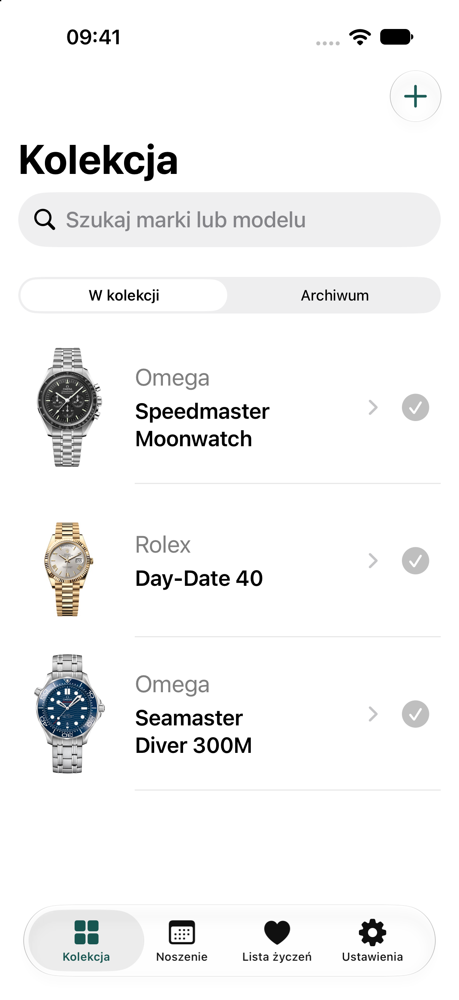 |  | 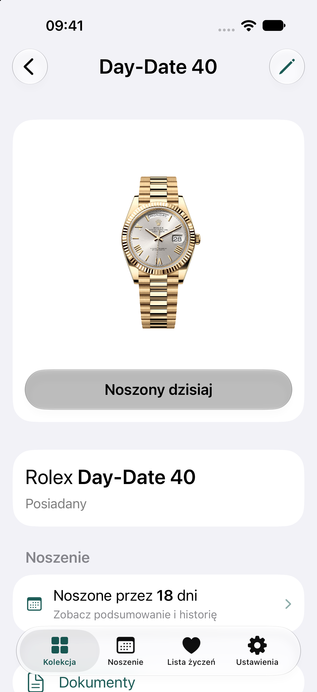 |
| Od codziennego towarzysza po wymarzony model. | Zdjęcia, notatki i historia konkretnego zegarka. | Każdy model ma własną kartę w kolekcji. |

## Zobacz, po co naprawdę sięgasz.

Jednym przyciskiem oznacz, co nosisz dzisiaj. Uzupełniaj wcześniejsze dni w kalendarzu, zaznaczając kilka dat naraz. Sprawdzaj historię całej kolekcji lub jednego zegarka. W statystykach zobacz liczbę dni noszenia, udział w zapisanej historii i porównanie modeli — z ostatnich 30 dni, bieżącego roku albo całego okresu.

| Twój rytm, dzień po dniu | Ulubione zegarki w liczbach | Następny zakup zaczyna się od pomysłu |
| :---: | :---: | :---: |
| 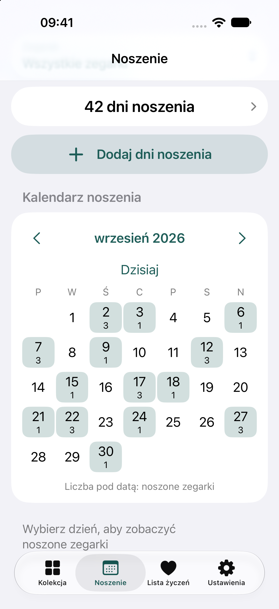 | 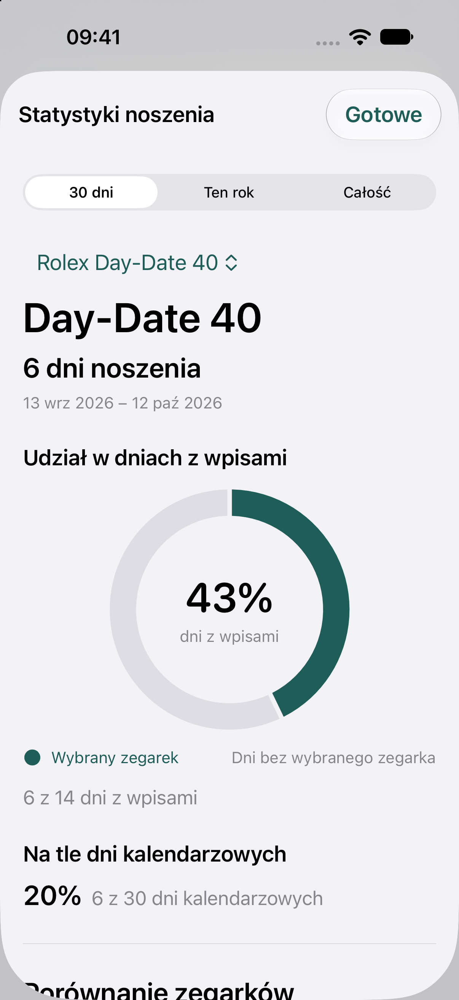 | 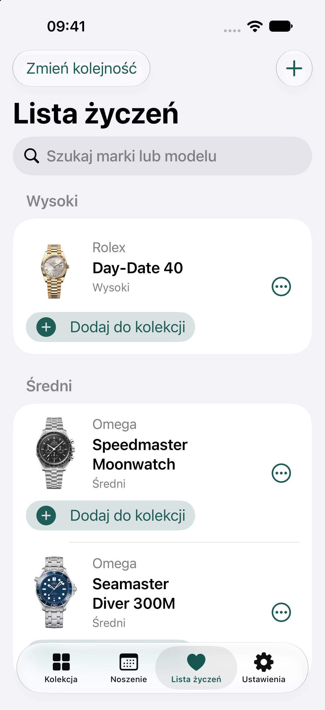 |
| Wracaj do konkretnego dnia i jego zegarków. | Odkryj, który model najczęściej trafia na nadgarstek. | Zapisuj plany i porządkuj je według własnych priorytetów. |

## Od marzenia do kolekcji.

Na liście życzeń zachowasz zdjęcie, link, orientacyjną cenę i notatki. Nadaj priorytet, wyszukuj modele i zmieniaj kolejność w obrębie grupy. Po zakupie dodaj zegarek do kolekcji bezpośrednio z listy albo najpierw uzupełnij jego szczegóły. Przypadkowe szybkie przeniesienie możesz cofnąć.

## Równie dobrze po zmroku.

Natywny interfejs dopasowuje się do jasnego lub ciemnego motywu iPhone’a. Ta sama kolekcja, kalendarz i plany — w oprawie pasującej do Twojego dnia.

| Kolekcja | Szczegóły zegarka | Lista życzeń |
| :---: | :---: | :---: |
| 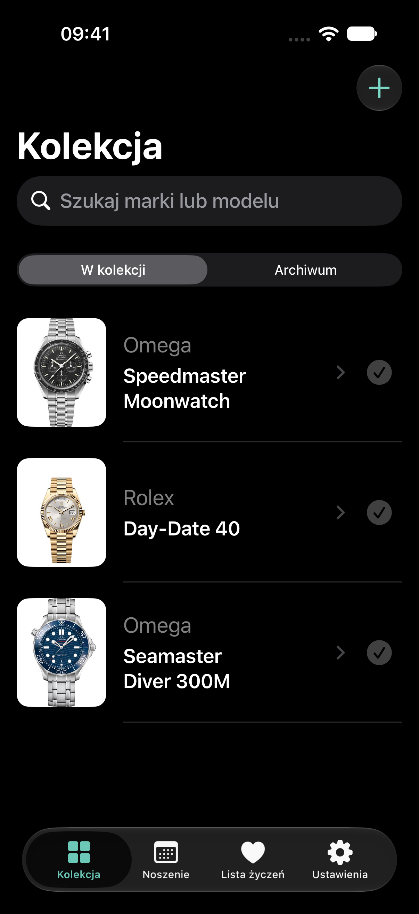 | 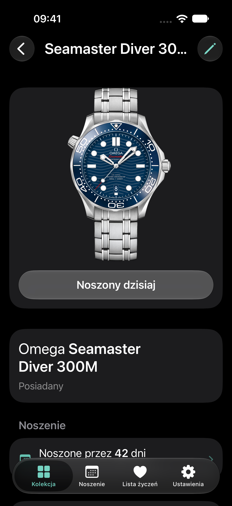 | 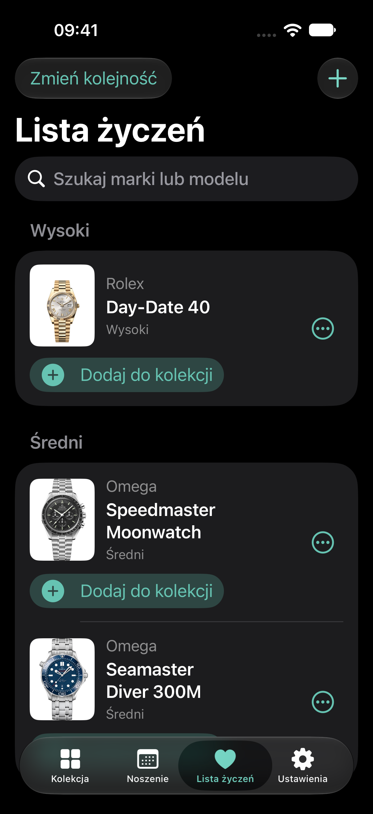 |

| Kalendarz noszenia | Statystyki noszenia | Rolex Day-Date 40 |
| :---: | :---: | :---: |
| 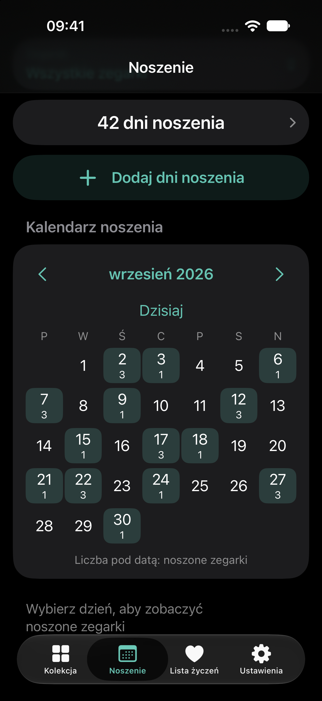 | 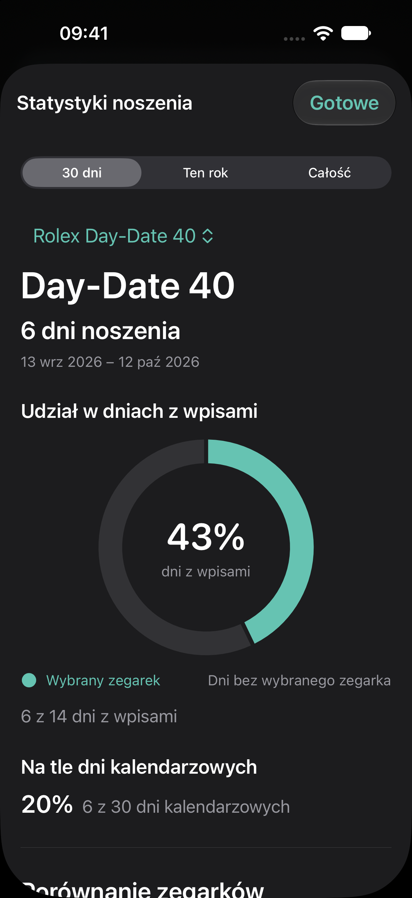 | 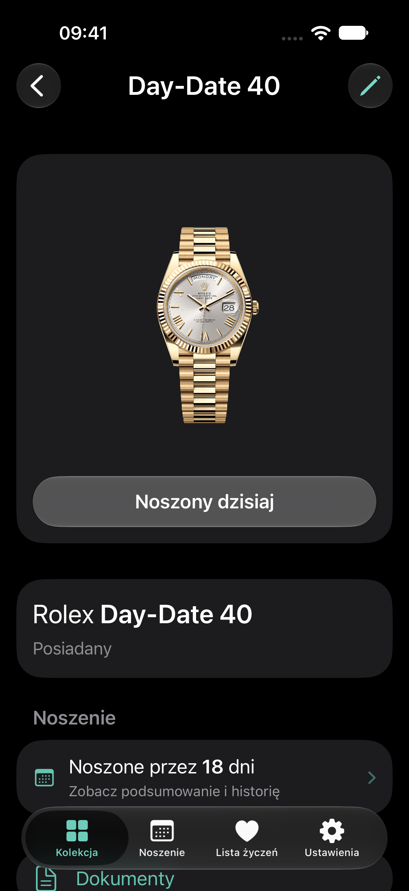 |

## Prywatna kolekcja. Po Twojemu.

- **Bez konta i reklam.** Kolekcja, historia i dokumenty działają lokalnie, również bez internetu.
- **Bez limitu liczby zegarków.** Dodawaj kolejne modele, zdjęcia i dokumenty; pojedynczy dokument może mieć do 20 MB.
- **Z opcjonalną blokadą dostępu.** Chroń interfejs Face ID lub kodem urządzenia. Przy włączonej blokadzie zawartość jest też zasłaniana w przełączniku aplikacji.
- **Po polsku lub angielsku.** Interfejs obsługuje oba języki, systemowe rozmiary tekstu i funkcje dostępności.

**Twoje zegarki. Twoje wybory. Twoja historia.**

## Z prawdziwego iPhone’a

Zrzuty z fizycznego iPhone’a 15 Pro pokazują używaną kolekcję z Casio Duro, rzeczywistą historię noszenia i listę życzeń. To dodatkowa galeria obok kolekcji demonstracyjnej.

| Kolekcja | Casio Duro | Lista życzeń |
| :---: | :---: | :---: |
| 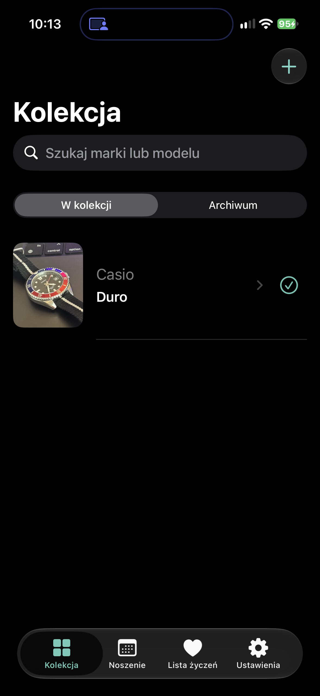 | 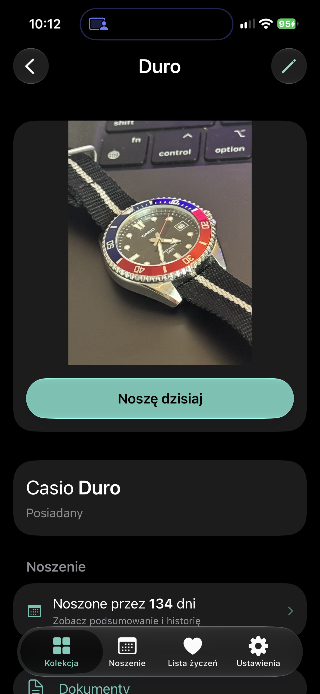 | 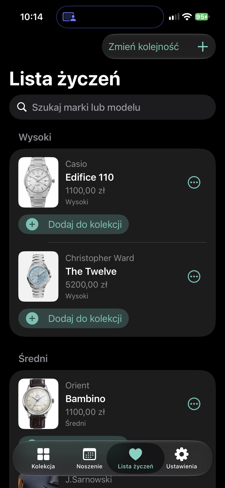 |

| Historia w kalendarzu | Statystyki używanej kolekcji |
| :---: | :---: |
| 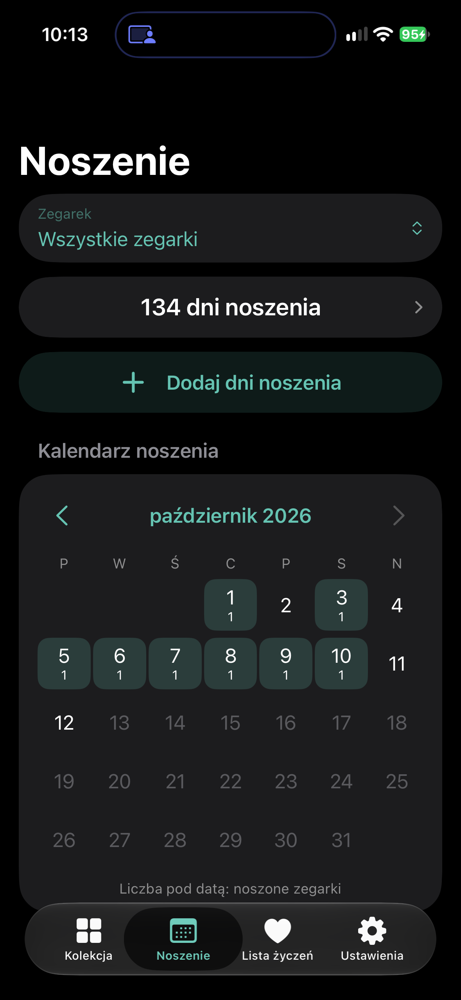 | 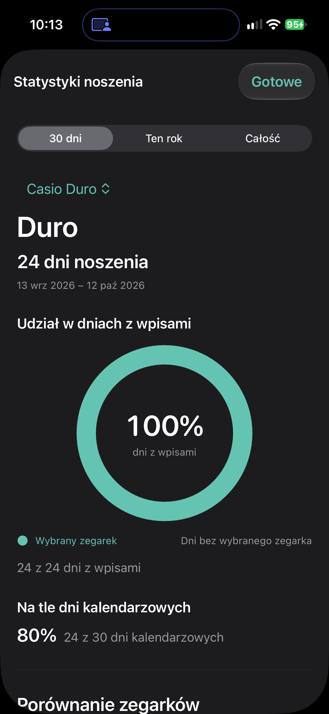 |

## Status aplikacji i materiały

Stan materiałów: **12.10.2026**. Aplikacja jest rozwijana i dystrybuowana w becie przez TestFlight; publiczna wersja App Store nie została jeszcze wydana. Aktualny kod ma wersję **0.8.5 (6)**. Szczegóły wysyłek i dystrybucji opisuje [dokumentacja TestFlight](../testflight/README.md).

iPhone · iOS 17 lub nowszy · PL/EN. Obecny zakres FREE obejmuje kolekcję, Archiwum, zdjęcia, dokumenty, kalendarz i statystyki noszenia, listę życzeń oraz opcjonalną blokadę. Synchronizacja iCloud pozostaje planowanym etapem Premium.

### Pochodzenie zrzutów

- **Główna galeria:** symulator iPhone 18 Pro / iOS 27.0, aktualny interfejs z kodu 0.8.5 (6). Osobna instalacja demonstracyjna zawiera przykładowe zegarki i fikcyjną historię noszenia. Nie jest to deklaracja posiadania pokazanych modeli ani katalog dostarczany z aplikacją.
- **Galeria fizycznego urządzenia:** iPhone 15 Pro / iOS 27.0.1, zainstalowana beta 0.8.4 (5), zweryfikowana na ekranie Ustawień. Różni się od 0.8.5 m.in. układem przycisków listy życzeń.
- Ekrany przygotowano przez Xcode DeviceHub. Pliki PNG przedstawiają rzeczywisty interfejs aplikacji; nie retuszowano jego kontrolek ani zawartości. Na zrzutach fizycznego telefonu widoczny jest systemowy wskaźnik połączenia z DeviceHub.
- Zestaw obejmuje **17 zrzutów**: 12 z symulatora (po 6 w jasnym i ciemnym motywie, 1206 × 2622 px) oraz 5 z telefonu (ciemny motyw, 1179 × 2556 px). Na symulatorze ujednolicono pasek statusu do godziny 09:41 i pełnej baterii.

### Zdjęcia zegarków

Fotografie kolekcji demonstracyjnej pochodzą z oficjalnych stron producentów i zostały dodane do aplikacji jako zdjęcia zegarków:

| Model | Referencja | Źródło |
| --- | --- | --- |
| OMEGA Seamaster Diver 300M | 210.30.42.20.03.001 | [OMEGA — strona modelu](https://www.omegawatches.com.hk/en-hk/watch-omega-seamaster-diver-300m-co-axial-master-chronometer-42-mm-21030422003001) |
| Rolex Day-Date 40 | 228238, wariant m228238-0002 | [Rolex — strona modelu](https://www.rolex.com/en-us/watches/day-date/m228238-0002) |
| OMEGA Speedmaster Moonwatch | 310.30.42.50.01.002 | [OMEGA — strona modelu](https://www.omegawatches.com.hk/en-hk/watch-omega-speedmaster-moonwatch-professional-co-axial-master-chronometer-chronograph-42-mm-31030425001002) |

Prawa do zdjęć i znaków marek należą do ich właścicieli. Materiał nie sugeruje współpracy z OMEGA ani Rolex. Nie uzyskano licencji reklamowej na fotografie producentów; przed publiczną kampanią zastąp je własnymi zdjęciami lub uzyskaj odpowiednią zgodę. Zdjęcia z fizycznego telefonu pochodzą z istniejącej kolekcji i listy życzeń właściciela.
